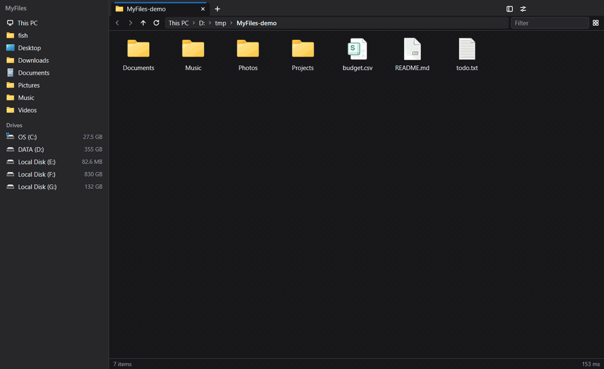

<p align="center">
  
</p>

<h1 align="center">MyFiles</h1>

<p align="center">
  <a href="https://github.com/f1sherb0y/MyFiles/releases/latest">下载安装包</a>
</p>

一个快、紧凑的 Windows 文件管理器，用来替代资源管理器。界面用 [MyGo](https://github.com/egoist/mygo) 的原生 UI 在 GPU 上画，纯 Go，没有 cgo，单个 12 MB 的 exe。

**浏览和切换视图**


**分屏和设置标签页**



**输入地址和过滤**


- **快**：进一个文件夹，从发出导航到画面交给显示，本地磁盘上是 3–7 ms（5,000 项的 System32 约 6 ms，26,000 项的 WinSxS 约 25 ms）。同一台机器上 Explorer++ 是 53 ms–14.8 s，最小差距 16 倍；测法和完整数字见 [docs/benchmark.md](docs/benchmark.md)。文件夹的第一帧尽量就是最终的画面：见过的类型的图标和类型名直接在，没见过的最多等 10 ms，不会先排错列数再跳一下。
- **标签 + 分屏**：把标签拖到窗格的上、下、左、右边缘就分屏，拖到别的窗格就并过去，像窗口贴靠。
- **地址栏**：每一级路径是一个按钮；点空白处或按 Ctrl+L 变成输入框，可以输入、复制、粘贴。
- **文件操作**：标签之间、窗格之间、和别的程序之间拖放；Ctrl+C / X / V 和资源管理器互通。
- **默认打开方式**：选择应用时勾选「设为系统默认打开方式」，同时更新 Windows 的文件关联，在资源管理器里打开同类文件也会使用所选应用。支持 Windows 10 和 Windows 11。
- **多种视图**：详细信息、列表、平铺、中 / 大 / 超大图标；图标视图里图片和视频显示缩略图。
- **侧栏**：固定的文件夹（首次从资源管理器的快速访问导入）、最近用过的文件夹，以及此电脑、网络、WSL 发行版的可展开树。
- **不占着文件夹**：标签开在一个文件夹里，不妨碍别的程序改它上级文件夹的名、移动或删除它；文件夹被改名，标签跟着走。
- **回收站**：在标签里打开，可以排序、过滤、还原、永久删除、清空。
- **多语言**：英文和简体中文，默认跟随系统语言，也可以在设置里指定。
- **自动更新**：后台检查 GitHub 上的新版本并下载，好了之后左上角出现「重启以更新」。
- **安静**：没有导航的咔哒声，没有按键的叮声。
- **可以设成默认文件管理器**，也可以随时还原。

## 安装

到 [Releases](https://github.com/f1sherb0y/MyFiles/releases/latest) 下载 `myfiles-setup-<版本>-amd64.exe` 运行即可，只装给当前用户，不需要管理员权限；同一页的 `MyFiles-<版本>-portable-amd64.exe` 是免安装的单个文件。安装包没有代码签名，Windows 可能会提示「未知发布者」。

## 构建和运行

需要 Go 1.27。

```powershell
.\tools\setup-mygo.ps1      # 只需一次：取 MyGo 并打上 patches\mygo.patch
.\build.ps1                 # 生成 bin\myfiles.exe
.\bin\myfiles.exe D:\Code     # 打开一个文件夹
go test ./internal/...      # 测试（不弹窗口，不出声）
```

## 命令行

```
myfiles [选项] [路径...]

  每个路径开一个标签；路径是文件就打开它所在的文件夹并选中它。
  不带路径启动时恢复上次的标签和分屏。

  -n, --new-window         开新窗口，而不是在已运行的窗口里加标签
      --select <路径>      打开所在文件夹并选中
      --split <right|down> 第二个路径起放到旁边的窗格
      --set-default        设为默认文件管理器
      --unset-default      还原
  -h, --help   -v, --version
```

explorer.exe 的参数也认，所以别的程序按资源管理器的方式调用也行：

```
myfiles /select,D:\dir\file.txt
myfiles /e,/root,D:\dir
myfiles /n,D:\dir
myfiles shell:Downloads
myfiles file:///D:/dir
```

MyFiles 是单实例的：再次启动只是把参数交给正在运行的那个。

## 快捷键

| | |
|---|---|
| Ctrl+T / Ctrl+W / Ctrl+Shift+T | 新标签 / 关标签 / 重新打开刚关的 |
| Ctrl+Tab、Ctrl+1…9 | 切换标签 |
| Ctrl+\ / Ctrl+Shift+\ | 向右 / 向下分屏 |
| F6 | 切换窗格 |
| Alt+← / Alt+→ / Alt+↑、Backspace | 后退 / 前进 / 上一级 |
| Ctrl+L、Alt+D、F4 | 编辑地址 |
| Ctrl+F、F3 | 过滤当前文件夹 |
| Ctrl+Shift+1…6、Ctrl+滚轮 | 详细信息 / 列表 / 平铺 / 中 / 大 / 超大图标 |
| Ctrl+C / X / V、Delete、Shift+Delete、F2 | 复制 / 剪切 / 粘贴、删除、永久删除、重命名 |
| Ctrl+Shift+N | 新建文件夹 |
| Ctrl+Shift+C | 复制路径 |
| Ctrl+H | 显示 / 隐藏隐藏文件 |
| Ctrl+B | 侧栏 |
| Ctrl+, | 设置 |
| Ctrl+N | 新窗口 |
| Alt+Enter | 属性 |

鼠标：中键点文件夹路径的某一级、侧栏的位置，在新标签里打开；中键点标签关闭它；右键菜单的「More」子菜单里是系统和别的程序加的项（7‑Zip 之类的扩展），由 MyFiles 自己画；最后的「System Menu…」打开系统原生的右键菜单。

## 设为默认

设置（Ctrl+,）里有两个开关：「用 MyFiles 打开文件夹」和「Win+E 打开 MyFiles」。只改当前用户的注册表，不需要管理员权限；关掉时把原来的值原样写回。细节见 [docs/design.md](docs/design.md#默认文件管理器)。

## 范围之外

- 控制面板这类不是目录的位置：遇到就交给资源管理器（回收站除外，它在 MyFiles 里打开）。
- 别的程序调用「在文件夹中显示并选中」（`SHOpenFolderAndSelectItems`）时，系统直接找资源管理器的窗口，不经过文件夹关联，所以仍然是资源管理器。
- macOS：代码按平台分好了层，能编译，但 `shell` 包在 macOS 上还是桩。

## 文档

- [docs/design.md](docs/design.md)：分层、为什么快、从 Explorer++ 学了什么、MyGo 的补丁。
- [docs/benchmark.md](docs/benchmark.md)：实测数字和测法。
